# Концепт нового измерения: Кремниевый План (*The Silicon Plane* / *Byteverse*)

> **Проект:** Simple Byte Storage (Minecraft 1.20.1 · Forge)  
> **Статус:** Дизайн-документ / Концепт-архитектура  
> **Цель:** Превратить эндгейм-прогрессию мода из «сидения на базе у терминала» в полноценное техно-исследовательское приключение с уникальной генерацией мира, 8 биомами и редкими ресурсами для высокоуровневого крафта.

---

## 1. Зачем моду собственное измерение?

Большинство модов на цифровое хранение и автокрафт держат игрока исключительно на базе. Добавление собственного измерения решает сразу три задачи:

1. **Естественная прогрессия (Soft Gating):** базовая сеть (контроллер, накопитель, 1k–16k ячейки, терминалы, базовый автокрафт) остаётся полностью доступной в Обычном мире, чтобы не душить старт. А вот мощный мид/эндгейм (64k–1M ячейки, квантовая связь, параллельные ассемблеры, Библиотека рецептов, межпространственный беспроводной доступ) требует экспедиций в новое измерение.
2. **Синергия с фичами мода:** в экспедициях наконец-то раскрываются на 100% **Портативные байт-ячейки** (с автосбором лута), **Беспроводной терминал** (с Картой страховки и Картой инструментов), **Жидкостные ячейки** (для сбора хладагента) и **Скрипты**.
3. **Лорная целостность:** в Simple Byte Storage 1.4.0 уже существует редкий биом `Silicon Rift` с `Quantum Cluster` и `Corrupted Cell`. По лору, `Silicon Rift` — это **трещина (прорыв)** из *Кремниевого Плана* в Обычный мир: физическое пространство, куда уходят оцифрованные байты.

> **Важно для модпаков:** в серверном конфиге обязательно должна быть опция отключения гейткипинга или самого измерения (`enableDimension`, `requireDimensionForEndgame`), чтобы мод оставался гибким для сторонних сборок.

---

## 2. Как попасть в измерение (Врата Разлома)

Вместо стандартной «обсидиановой рамки с зажигалкой» используется технологический портал в стиле мода:

- **Каркас:** рамка минимум `4×5` (до `12×12`) из блоков **Кремниевого базальта** (крафтится из гладкого базальта, кварца и кремния или добывается в `Silicon Rift`).
- **Контроллер врат (Rift Gate Core):** устанавливается в основание рамки.
- **Активация:**
  1. Подвести к `Rift Gate Core` энергию (требует заряд **100 000 FE** для открытия).
  2. Вставить в слот ядра **Повреждённую байт-ячейку (`Corrupted Cell`)** или скрафченный **Ключ Разлома (`Rift Resonator`)**.
  3. После открытия рамка заполняется бирюзовым цифровым полем; поддержание портала требует небольшого расхода FE (или портал можно включать/выключать редстоуном).
- **Возврат:** на той стороне генерируется ответная платформа `Rift Gate` с небольшим встроенным энергобуфером, чтобы игрок никогда не застрял без возможности вернуться.

---

## 3. Уникальная генерация мира и атмосфера

Измерение **не должно** ощущаться как «Обычный мир, перекрашенный в синий». Его генерация строится по принципу **трёх вертикальных «слоёв памяти»** (`Y = -64 .. 256`):

```
Y = 220 ─── ┌─────────────────────────────────────────────────────┐
            │  СЛОЙ 3: ОБЛАЧНЫЙ АРХИВ (Парящие острова-кластеры)  │
Y = 120 ─── ├─────────────────────────────────────────────────────┤
            │  СЛОЙ 2: ОСНОВНЫЕ СЕКТОРА (Террасы, каньоны, леса)  │
Y =  20 ─── ├─────────────────────────────────────────────────────┤
            │  СЛОЙ 1: ГЛУБОКИЙ КЭШ (Гигантские полости и озёра)  │
Y = -64 ─── └─────────────────────────────────────────────────────┘
```

### Особенности генерации:
- **Геометрический (террасированный) рельеф:** вместо плавных земляных холмов — ступенчатые плато, шестигранные колонны, идеально ровные разломы-магистрали и кристаллические шпили.
- **Трёхуровневая вертикальность:**
  - *Глубокий Кэш (`Y = -64..20`):* огромные подземные залы с парящими кристаллическими столбами и озёрами **Жидкого Хладагента**.
  - *Основные Сектора (`Y = 20..120`):* главная поверхность с 6 наземными биомами.
  - *Облачный Архив (`Y = 120..220`):* парящие острова-платформы, до которых можно добраться на элитрах, строительством или по природным **магнитным восходящим потокам**.
- **Небо и освещение:**
  - Нет классического цикла дня и ночи (кровати и часы не работают стабильно; вместо сна — безопасный маяк возврата).
  - Тёмно-индиговый космос с медленно плывущим бирюзово-фиолетовым полярным сиянием и тонкой «матричной» сеткой на горизонте.
  - Ровное сумеречное освещение, подчёркивающее свечение руд, кристаллов и рек хладагента.

---

## 4. Восемь уникальных биомов

Каждый биом имеет свою цветовую палитру, уникальную геометрию, эксклюзивные ресурсы и роль в прогрессии.

| № | Биом | Слой | Визуал и генерация | Уникальные ресурсы | Опасность |
|---|---|---|---|---|---|
| 1 | **Кремниевые Террасы** *(Silicon Terraces)* | Основной | Стартовый биом. Ступенчатые плато из матового тёмно-серого кремнистого камня с бирюзовыми прожилками, невысокие кристаллы. | `Сырой кремний`, `Кремниевый сланец` | Низкая (безопасная точка входа) |
| 2 | **Оптоволоконный Лес** *(Optic Spirewood)* | Основной | Высокие полупрозрачные «деревья-антенны» с тёмными металлическими стволами и светящейся циановой листвой-кристаллами. | `Оптоволоконная древесина`, `Оптический кварц` | Низкая |
| 3 | **Магистральные Каньоны** *(Bus Canyons)* | Основной | Глубокие прямые геометрические каньоны с отвесными стенами, по дну которых текут реки **Жидкого Хладагента**. | `Жидкий хладагент`, `Проводниковая руда (Busium)` | Средняя (глубина, узкие мосты) |
| 4 | **Крио-Кэш** *(Cryo-Cache Wastes)* | Основной / Глубокий | Ледяные пустоши из идеальных шестигранных базальтовых колонн, покрытых голубым инеем и кристаллической наледью. | `Крио-силикат`, `Плотный крио-лёд` | Средняя (обморожение без защиты) |
| 5 | **Поля Конденсаторов** *(Capacitor Flats)* | Основной | Ровные тёмные плато, усеянные гигантскими природными столбами-резонаторами; между столбами периодически проскакивают дуги молний. | `Флюксит (Fluxite Ore)`, `Заряженная пыль` | Средняя–Высокая (электрические разряды) |
| 6 | **Битые Сектора** *(Corrupted Badlands)* | Основной | Искажённый фиолетово-чёрный «глитч»-биом: разорванный рельеф, зависшие в воздухе куски породы, поля `Quantum Cluster`. | `Осколок энтропии`, `Corrupted Cell` (частый дроп) | Высокая (эффект *Десинхронизации*) |
| 7 | **Парящий Архив** *(Cloud Archive)* | Облачный (`Y>120`) | Парящие острова с гладкими плитами, арками и древними монолитами-библиотеками. Соединены восходящими потоками. | `Квантиум (Quantumite Ore)`, `Архивные пластины` | Высокая (пропасть, стражи) |
| 8 | **Сердце Реестра** *(The Null Core)* | Глубокий (`Y<10`) | Редкий сверхглубокий биом-кратер с огромными обсидианово-золотыми пилонами вокруг центральной аномалии. | `Матричная руда (Matrix Ore)`, `Ядро Сингулярности` | Экстремальная (эндгейм-зона) |

---

## 5. Новые руды, жидкости и материалы

1. **Проводниковая руда (`Busium Ore`)** — *Магистральные Каньоны*  
   - Добывается железной/алмазной киркой. Переплавляется в `Проводниковый слиток`.
   - Нужна для продвинутых кабелей, 64k ячеек, улучшенных шин I/O и Шины шаблонов Mk2.
2. **Оптический кварц (`Optic Quartz`)** — *Оптоволоконный Лес*  
   - Выпадает кристаллами из светящихся жил и сердцевин опто-деревьев.
   - Нужен для ускорителей крафта, дисплеев высокого разрешения и оптических процессоров.
3. **Жидкий хладагент (`Liquid Coolant`)** — *Магистральные Каньоны и Глубокий Кэш*  
   - Новая жидкость мира: светится мягким голубым светом, при контакте ускоряет охлаждение, но замедляет игрока.
   - Собирается вёдрами или напрямую в **Fluid Byte Cell**. Используется для крафта **Крио-ядер**, карт ускорения Тир 2 и охлаждения параллельных ассемблеров.
4. **Крио-силикат (`Cryo-Silicate`)** — *Крио-Кэш*  
   - Добывается алмазной киркой. Основа для сверхплотных ячеек памяти (256k) и термостойких корпусов.
5. **Флюксит (`Fluxite`)** — *Поля Конденсаторов*  
   - Светящаяся янтарно-золотая руда у основания столбов-резонаторов.
   - Основа для **Энергоячеек 64k/256k**, усиленных конденсаторов и межпространственного энергопередатчика.
6. **Осколок энтропии (`Entropy Shard`)** — *Битые Сектора*  
   - Выпадает из нестабильных кластеров и мобов.
   - Нужен для стабилизации **Квантового ретранслятора** и восстановления редких `Corrupted Cell` с улучшенным лутом.
7. **Квантиум (`Quantumite`)** — *Парящий Архив*  
   - Редкая руда, требующая незеритовую (или Проводниковую/Крио) кирку.
   - Ключевой материал для **Библиотеки рецептов**, **Межпространственной карты беспроводного терминала** и **256k / 1M Байт-ячеек**.
8. **Матричная руда (`Matrix Ore`)** — *Сердце Реестра*  
   - Самый редкий материал измерения.
   - Используется для эндгейм-вершины: **1M+ Мегабайтных ячеек**, **Сингулярного контроллера** (нулевое энергопотребление/огромный буфер) и **Параллельного мега-ассемблера**.

---

## 6. Дерево прогрессии (Тиры 1–4)

```mermaid
flowchart LR
    T1["Тир 1: Обычный мир\nКонтроллер, 1k-16k ячейки,\nТерминал, Базовый автокрафт"]
    P["Врата Разлома\n100k FE + Corrupted Cell"]
    T2["Тир 2: Внешние Сектора\nТеррасы, Лес, Каньоны\nBusium + Optic Quartz + Coolant"]
    T3["Тир 3: Опасные Зоны\nКрио-Кэш, Конденсаторы, Битые Сектора\nCryo-Silicate + Fluxite + Entropy"]
    T4["Тир 4: Эндгейм Архива\nПарящий Архив + Сердце Реестра\nQuantumite + Matrix Ore"]

    T1 --> P --> T2
    T2 --> |"64k ячейки, Ускорители Mk2,\nПортативные 4k/16k"| T3
    T3 --> |"256k ячейки, Квантовая связь,\nЭнергоячейки 64k, Продв. Ассемблер"| T4
    T4 --> |"1M ячейки, Библиотека рецептов,\nМежпространственный Терминал"| END["Полное господство над сетью"]
```



### Как это влияет на существующие и новые предметы:
- **Остаётся в Обычном мире (Тир 1):** Контроллер, Накопитель, Кабель, Терминал, Терминал крафта, Терминал шаблонов/кодирования, обычный Ассемблер, I/O-шина, Сетевой интерфейс, 1k / 4k / 16k ячейки, Портативная 1k ячейка, Логическая шина и Терминал скриптов.
- **Переносится/добавляется в Тир 2:** 64k Байт-ячейка, Портативные 4k/16k ячейки, Карта ускорения Mk2, Жидкостная ячейка 64k, Фасадный сканер.
- **Тир 3:** **256k Байт-ячейка**, **Квантовый ретранслятор**, **Энергоячейка 64k**, **Продвинутый Ассемблер** (крафтит 4–8 задач одновременно), **Компас биомов Разлома**.
- **Тир 4:** **1M Байт-ячейка**, **Библиотека рецептов**, **Межпространственная карта** для Беспроводного терминала (работает из любого измерения без ограничений по дистанции), **Сингулярный Ассемблер**.

---

## 7. Структуры, опасности и существа

Чтобы мир не казался пустым полем с рудой, его оживляют 3 элемента:

### Структуры
1. **Серверные Башни** *(Террасы / Каньоны)* — высокие геометрические башни с паркур-лестницами и сундуками, в которых лежат шаблоны, ячейки 1k–16k, `Script Disk` с готовыми скриптами-пасхалками.
2. **Узлы Хладагента** *(Каньоны / Крио-Кэш)* — полуразрушенные резервуары с ценным хладагентом и крио-блоками.
3. **Повреждённые Хранилища** *(Битые Сектора)* — мини-данжи с ловушками-разрядами, охраняемые дронами; главный источник `Corrupted Cell` и `Entropy Shard`.
4. **Монолиты Архива** *(Парящий Архив)* — величественные алтари с богатыми жилами `Quantumite` и фрагментами лора в записках.

### Уникальные механики среды
- **Десинхронизация (Glitch)** *(Битые Сектора):* периодически накладывает короткие визуальные помехи и сдвиг позиции на 1–2 блока, если у игрока нет **Стабилизатора фазы** (аксессуар из Крио-силиката + Флюксита).
- **Восходящие магнитные потоки:** вертикальные столбы синих частиц, поднимающие игрока вверх к **Парящему Архиву** (как природные лифты).
- **Разряды конденсаторов:** в *Полях Конденсаторов* перед ударом молнии столб начинает гудеть и ярко светиться (2 секунды предупреждения) — можно либо увернуться, либо **поймать заряд** специальным аккумулятором!

### Мобы (компактный, но яркий ростер)
1. **Байт-Страж *(Byte Sentinel)*** — парящий геометрический дрон с циановым глазом. Нейтрален в Террасах, агрессивен в Архиве и Хранилищах. Стреляет импульсами энергии, дропает кремниевые пластины и батареи.
2. **Глитч-Сталкер *(Glitch Stalker)*** — обитатель *Битых Секторов*. Телепортируется на короткие дистанции с эффектом цифрового шума, дропает `Entropy Shard`.
3. **Крио-Сборщик *(Cryo-Harvester)*** — мирный/нейтральный голем в *Крио-Кэше*, который медленно «добывает» кристаллы; атакует только если игрок ломает блоки рядом с ним.
4. *(Опционально в будущем)* **Хранитель Реестра *(Registry Warden)*** — мини-босс в *Сердце Реестра*, открывающий доступ к залежам `Matrix Ore`.

---

## 8. Техническая архитектура (Minecraft 1.20.1 · Forge)

В Minecraft 1.20.1 вся генерация измерений **полностью data-driven** (JSON в `data/simple_bytestorage/`), что делает реализацию чистой и поддерживаемой:

- `dimension_type/silicon_plane.json` — параметры неба, освещения, высоты (`min_y: -64`, `height: 320`), отключение естественного цикла дня/ночи.
- `dimension/silicon_plane.json` — привязка `multi_noise` источника биомов (8 биомов по параметрам `temperature`, `humidity`, `continentalness`, `erosion`, `depth`, `weirdness` — параметр `depth` идеально разделяет Глубокий Кэш, Основные Сектора и Облачный Архив!).
- `worldgen/noise_settings/silicon_plane.json` — кастомные `density_function` для ступенчатых террас, прямых каньонов и парящих островов сверху.
- `worldgen/biome/*.json` (8 файлов) — цвета тумана/неба/воды, звуковой эмбиент, спавн мобов, список фич.
- `worldgen/configured_feature` & `placed_feature` — жилы 8 руд, оптоволоконные деревья, шестигранные колонны, столбы-конденсаторы, кластеры.
- `worldgen/structure` & `structure_set` — NBT-структуры башен, монолитов и хранилищ.
- **Клиентский рендер:** кастомный `DimensionSpecialEffects` для уникального индиго-неба, сетки и полярного сияния.
- **Портал:** кастомный `ITeleporter` + `RiftGateCoreBlockEntity` для безопасного поиска/создания площадки на другой стороне.

---

## 9. Поэтапная дорожная карта (чтобы не утонуть в объёме)

Реализовывать 8 биомов, структуры и мобов за один присест рискованно — лучше разбить работу на **4 последовательных этапа**:

| Этап | Содержание | Результат |
|---|---|---|
| **Этап 1: Каркас (MVP)** | `DimensionType`, `Rift Gate` (портал), базовый шум террас + кастомное небо, 3 базовых биома (*Террасы*, *Оптоволоконный Лес*, *Магистральные Каньоны*), `Busium`, `Optic Quartz`, `Liquid Coolant`. | Полностью рабочее, играбельное измерение, куда можно зайти и добыть Тир 2 ресурсы. |
| **Этап 2: Полная карта (все 8 биомов)** | Добавление *Крио-Кэша*, *Полей Конденсаторов*, *Битых Секторов*, *Парящего Архива* и *Сердца Реестра* + все 8 руд, восходящие потоки и 3-слойная генерация. | Полный масштаб мира и вся линейка ресурсов Тир 2–4. |
| **Этап 3: Прогрессия и эндгейм-крафт** | Новые ячейки (`256k`, `1M`), `Продвинутый Ассемблер`, `Межпространственная карта`, `Компас биомов`, интеграция рецептов в `Guide Book`, конфиг гейткипинга. | Измерение становится смысловым центром эндгейма Simple Byte Storage. |
| **Этап 4: Жизнь мира** | 4 типа структур с лутом (`Script Disk`, `Corrupted Cell`), 3 моба, эффекты среды (*Десинхронизация*, молнии конденсаторов) и опциональный мини-босс в *Сердце Реестра*. | Максимальная глубина и реиграбельность. |

---

## 10. Открытые вопросы для обсуждения

Перед началом реализации стоит решить 3 дизайнерских вопроса:
1. **Жёсткость гейткипинга:** хотим ли мы, чтобы *уже существующие* эндгейм-предметы (64k ячейка, Квантовый ретранслятор, Библиотека рецептов) требовали ресурсы из измерения, или лучше оставить старые рецепты как есть и привязать к измерению **новые, ещё более мощные тиры** (256k/1M, Продвинутый ассемблер, Межпространственный беспроводной доступ)?
2. **Объём старта:** начинаем сразу с **Этапа 1 (MVP: портал + 3 биома + 3 ресурса)** и проверяем в игре, или сразу проектируем все 8 биомов?
3. **Модуль:** делать измерение частью основного мода `simple_bytestorage` или вынести в отдельный опциональный аддон (как `simple_bytestorage_scripting`)?
